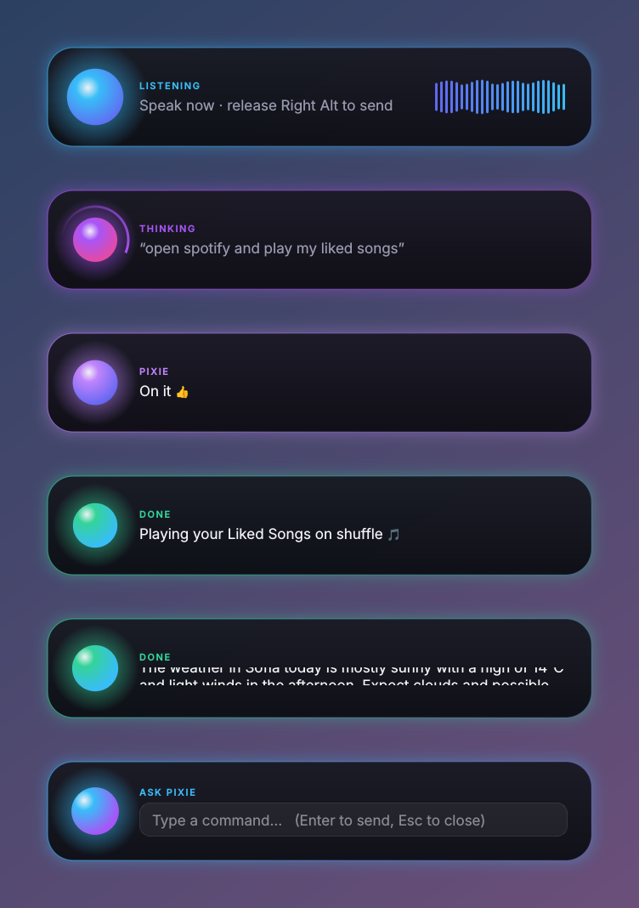

# Pixie 🧚 — my own Jarvis

Pixie is a personal desktop AI assistant for Windows, inspired by Jarvis and Nixi.
**Hold Right Alt, say what you want, let go.** A small popup appears in the middle of your screen,
Pixie answers, and the work happens **in the background**. Nothing steals focus from what you're doing.
The AI runs **100% locally** through [Ollama](https://ollama.com), so it's free and private.

<p align="center"></p>

> **Status:** 🚧 v0.2: popup UI, hold-to-talk voice, background tasks, apps, Spotify, web search, email drafts, modes.

---

## ✨ What Pixie can do

| Category | Example commands | Status |
|---|---|---|
| 🎵 **Spotify** | "Play Numb by Linkin Park", "Play the album Meteora", "Play Eminem", "Play my gym playlist", "Queue Blinding Lights", "What's playing?", "Like this song", "Skip", "Shuffle on" | ✅ |
| 🚀 **Apps & games** | "Open Discord", "Open dc and spotify", "Launch GTA 5", "Close Chrome", "What games do I have?" | ✅ |
| 🌐 **Browser** | "Open YouTube", "Play lofi hip hop on YouTube", "Open emag.bg", "Search RTX 4070 on emag", "Show me Sofia on maps" | ✅ |
| 🖥️ **Windows** | "Volume 30", "Mute", "Pause the music", "Brightness up", "Dark mode", "Lock the PC", "Shut down" (60 s, cancellable), "Take a screenshot", "Battery?" | ✅ |
| 🔎 **Search** | "What's the weather in Sofia?", "Search best RTX 4070 laptops": you get a short summary, no browser tab | ✅ |
| ✉️ **Emails** | "Write an email to my professor asking for an extension": the draft is **copied to your clipboard** | ✅ |
| 🎮 **Modes** | "Activate game mode" opens Discord, plays your liked songs and launches your game | ✅ |
| 🎙️ **Voice** | Hold **Right Alt** and talk, with local Whisper speech-to-text | ✅ |
| ⌨️ **Typing** | **Double-tap Right Alt** to type a command instead | ✅ |
| 💬 **Text replies** | Pixie answers in the popup only. It never talks out loud | ✅ |

### The popup
| You do | Pixie shows |
|---|---|
| **Hold Right Alt** | 🔵 *Listening*: the orb and bars react to your voice |
| **Release** | 🟣 *Thinking*: what you said, while it decides |
| | 💜 *Reply*, e.g. "On it 👍", then the popup fades away |
| (task finishes) | 🟢 *Done*, e.g. "Playing your Liked Songs on shuffle 🎵" |
| **Double-tap Right Alt** | ⌨️ a text box. Enter sends, Esc closes |

- The popup **never steals focus** (except the text box), so it's safe to use mid-game.
- Pressing Right Alt together with another key (AltGr shortcuts like `AltGr+Q` → `@`) is ignored,
  so normal typing never triggers Pixie.
- Pixie lives in the **system tray**: right-click it to type a command or quit.

### Background-first
- **Apps open in the background.** If an app pops up anyway (Discord, Store apps…), Pixie instantly
  minimizes that new window and gives focus back to you. Your other windows are never touched.
  Games are the exception: they open normally. Say *"open X and show it"* to see an app.
- **Websites open in a new, minimized browser window** of your default browser (Brave, Chrome, Edge, Firefox).
  YouTube keeps playing from there.
- Pixie replies instantly ("On it 👍") and runs the work as a **background task**, so you can keep
  typing new commands or keep gaming.
- When a task finishes you get a **Windows notification**.
- Spotify is controlled through the **Spotify Web API**, so Liked Songs start playing without the
  Spotify window ever coming to the front. If Spotify isn't running, Pixie starts it minimized.
- Apps and games are launched **minimized and unfocused**.

### Safety
Pixie **never sends emails**. It only writes drafts for you to paste and send yourself.
Anything destructive (like deleting files) will always ask for confirmation first.

---

## 🧠 How it works

```
 🎙️ hold Right Alt: "open spotify and play my liked songs"
        │  Whisper (local) → text
        ▼
 ┌────────────┐     ┌──────────────┐     ┌────────────────────┐
 │   Brain    │ ──► │ Task runner  │ ──► │       Tools        │
 │ local LLM  │     │ asyncio jobs │     │ play_liked_songs() │
 │ (Ollama)   │     │ in threads   │     │ open_app() ...     │
 │ picks tool │     └──────────────┘     └────────────────────┘
 └────────────┘            │
        │                  ▼
 popup: "On it 👍"   popup: "Playing your Liked Songs on shuffle 🎵"
```

1. **Brain** (`pixie/brain.py`) sends your message to the local LLM with a list of tools. The LLM
   answers with **tool calls**, e.g. `play_liked_songs(shuffle=true)`.
   Exact mode phrases like "activate game mode" skip the LLM, so they run instantly.
2. **Task runner** (`pixie/tasks.py`) runs every tool call as a background job.
3. **Tools** (`pixie/tools/`) are plain Python functions with a `@tool` decorator.
   **Adding a skill = adding a function.**

```python
from . import tool

@tool("lock_pc", "Lock the computer.")
def lock_pc() -> str:
    import ctypes
    ctypes.windll.user32.LockWorkStation()
    return "PC locked 🔒"
```

---

## 🚀 Getting started (Windows)

### 1. Install Ollama + a model
Download Ollama from [ollama.com](https://ollama.com), then:
```bash
ollama pull qwen2.5:7b
```
`qwen2.5:7b` is good at tool calling and runs well on a GPU with ~8 GB VRAM.
If you have more VRAM you can use `qwen2.5:14b`, and on weaker hardware `llama3.2:3b`.

### 2. Install Pixie
```bash
git clone https://github.com/yavmomdev/Pixie-Jarvis.git
cd Pixie-Jarvis
python -m venv .venv
.venv\Scripts\activate
pip install -r requirements.txt
copy config.example.yaml config.yaml
```

### 3. Connect Spotify (optional, needs Spotify Premium)
1. Go to the [Spotify Developer Dashboard](https://developer.spotify.com/dashboard) → **Create app**.
2. Set the Redirect URI to `http://127.0.0.1:8888/callback` and select **Web API**.
3. Put the **Client ID** and **Client Secret** into `config.yaml`.
4. The first time you play something, a browser opens once so you can log in.
   (After updating Pixie you may be asked to log in once more, because Pixie now asks for extra
   permissions to read your playlists and like songs.)

### 4. Run

> ⚡ **Shortcut:** just double-click `start-pixie.bat`. It installs Python, Ollama, the AI model and all
> packages if they are missing, and then starts Pixie. You can skip steps 1, 2 and 4.

```bash
python -m pixie              # popup UI, hold Right Alt to talk
pythonw -m pixie             # same, without a console window
python -m pixie --console    # text-only mode in the terminal
```
The first start downloads the Whisper speech model (`small` ≈ 500 MB), and after that it's instant.
Then **hold Right Alt** and say *"open Spotify and play my liked songs"*.

> 💡 **GPU speech-to-text:** Whisper runs on your NVIDIA GPU if CUDA libraries are available
> (`pip install nvidia-cublas-cu12 nvidia-cudnn-cu12`), otherwise it falls back to the CPU automatically.
> With a GPU, set `voice.stt_model: large-v3-turbo` for the best accuracy (also for Bulgarian).
>
> 🎮 **Games running as administrator** can block global hotkeys. If Right Alt doesn't work in a
> game, run Pixie as administrator too.

---

## ⚙️ Configuration

Everything lives in `config.yaml` (it's git-ignored, so your keys stay private):

- `ollama.model`: which local model to use
- `ui.hotkey`: the hold-to-talk key (default `alt_r`, Right Alt); `ui.position`: `center` / `top` / `bottom`
- `voice.stt_model` / `voice.language`: the Whisper model and language (`null` = auto-detect)
- `apps`: your own nicknames. Usually not needed, because Pixie finds your apps by itself (see below).
- `spotify`: API keys

### How Pixie finds your apps
At startup Pixie scans your PC and builds a list of everything you can open:
- every app in the **Start menu** and on your **Desktop**
- **Microsoft Store apps** (Spotify, WhatsApp… from the Store)
- installed **Steam** games and **Epic Games**

You can say it however you like: *"open discord"*, *"open dc"*, *"launch gta 5"*, *"open vs code"*,
even typos like *"spotfy"*. If the name isn't an obvious match, the local AI picks the right app from
your list, and if you don't have the app at all, Pixie tells you instead of guessing.
Ask *"what games do I have?"* to see the list. New apps are picked up automatically.

### Modes
A mode is a YAML file in `modes/`, holding a list of tool calls:

```yaml
# modes/game_mode.yaml
name: game mode
triggers: ["activate game mode", "game mode on"]
delay: 2
steps:
  - open_app: {name: discord}
  - play_liked_songs: {shuffle: true}
  - open_app: {name: valorant}
```

> ℹ️ Discord has no official way to auto-join a voice call, so for now game mode just opens Discord.

---

## 📂 Project structure

```
Pixie-Jarvis/
├── pixie/
│   ├── __main__.py      # python -m pixie  (popup UI, or --console)
│   ├── app_index.py     # finds every app & game on the PC
│   ├── winctl.py        # keeps launched windows in the background
│   ├── hotkey.py        # hold Right Alt to talk, double-tap to type
│   ├── ui/
│   │   ├── app.py       # tray icon + wiring: voice → brain → tasks → popup
│   │   └── overlay.py   # the center popup (orb, mic bars, animations)
│   ├── voice/
│   │   ├── recorder.py  # microphone
│   │   └── stt.py       # local Whisper speech-to-text
│   ├── brain.py         # LLM → tool calls
│   ├── tasks.py         # background task runner
│   ├── llm.py           # Ollama client
│   ├── notify.py        # Windows notifications
│   ├── config.py
│   └── tools/           # one file per skill
│       ├── apps.py      # open / close / list apps & games
│       ├── browser.py   # websites, YouTube, search in the browser
│       ├── system.py    # volume, media keys, brightness, dark mode, power, screenshot
│       ├── spotify.py   # search & play songs/albums/artists/playlists, queue, like
│       ├── search.py    # DuckDuckGo + LLM summary
│       ├── email.py     # email drafts → clipboard
│       └── modes.py     # run modes from modes/*.yaml
├── modes/
│   └── game_mode.yaml
├── config.example.yaml
└── requirements.txt
```

---

## 🗺️ Roadmap

- [x] **v0.1**: text commands → local LLM → tools (apps, Spotify, search, email drafts, modes), background tasks + notifications
- [x] **v0.2**: center popup UI, hold Right Alt to talk (local Whisper), double-tap to type, tray icon
- [ ] **v0.4**: file tools (find, organize, clean up Downloads)
- [ ] **v0.5**: more modes (study mode, focus mode) and auto-start with Windows
- [ ] Later: remembering preferences, multi-step tasks, plugins

---

## 📄 License

[MIT](LICENSE) © 2026 yavmomdev
